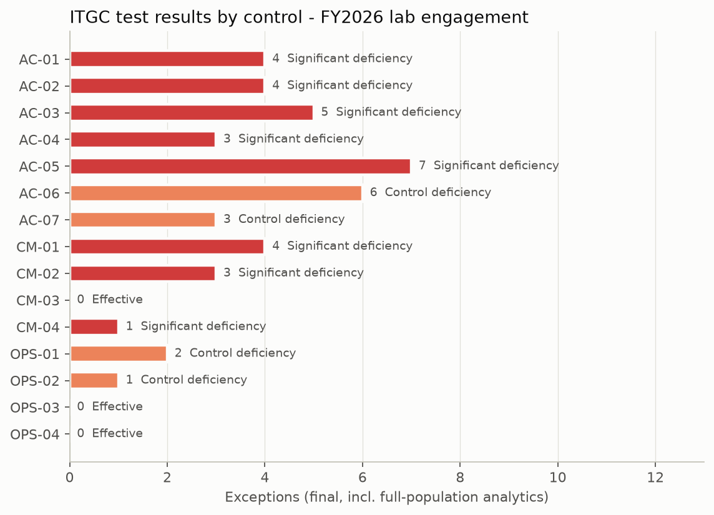
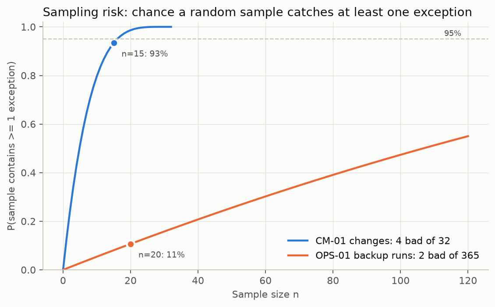
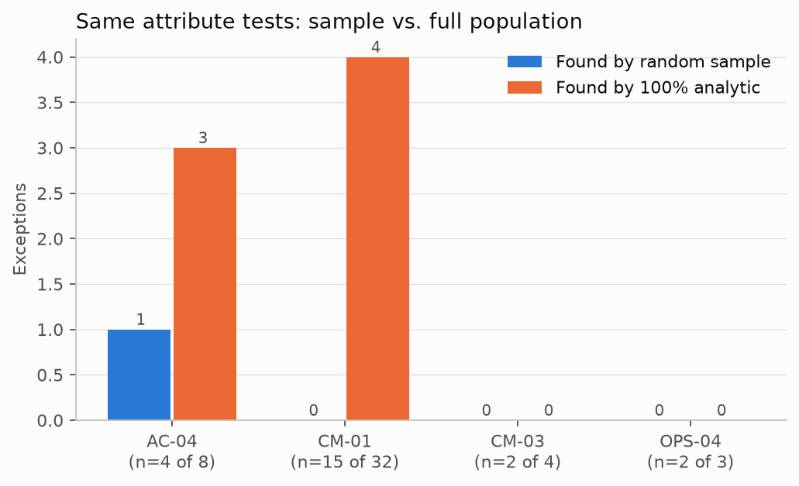
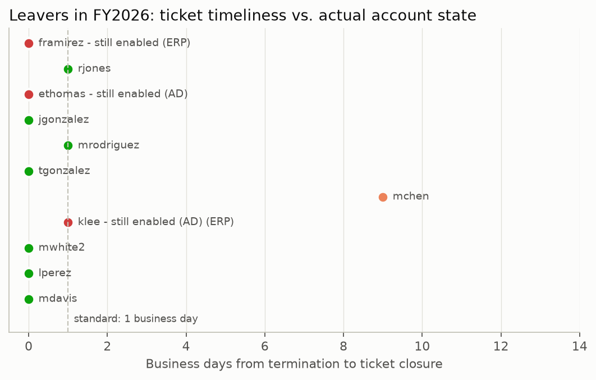
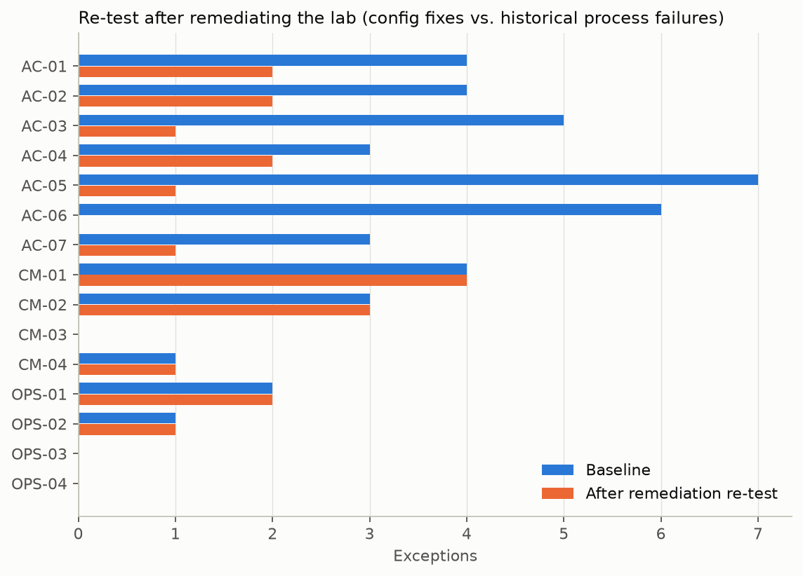
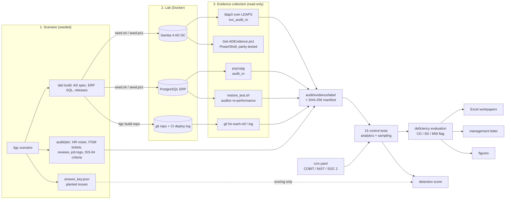

# itgc-audit-lab

**A Big-4-style IT General Controls (ITGC) audit, performed end to end on a lab I built: an Active Directory domain, an ERP database and a release pipeline, tested with code-driven evidence collection, sampling, Excel workpapers, deficiency evaluation and a management letter.**

> **Data notice.** The company ("Kestrel Valve Co."), its 81 people, tickets, review sign-offs and job logs are **synthetic** (generated by a seeded script). The *systems* are real: a Samba 4 AD domain controller, a PostgreSQL ERP database and a git/CI repository were stood up in Docker and seeded, and every piece of system evidence was pulled from them **live, over LDAPS / SQL / git, with read-only audit accounts**. Issues were deliberately planted; the control tests never read the list of planted issues (it is only used afterwards to score detection).

[](https://github.com/AwpDemon/itgc-audit-lab/actions/workflows/ci.yml)

## Results

Engagement period FY2026 (1 Oct 2025 - 30 Sep 2026); evidence bundle `audit/evidence/fy26-baseline` (95 AD user objects, 51 ERP users, 7 DB login roles, 32 production releases, 365 backup runs, 261 batch runs, 38 incidents).

| | |
|---|---|
| Controls tested | **15** (7 access, 4 change, 4 operations; 12 key) |
| Not effective | **12** - 8 significant deficiencies, 4 control deficiencies; 1 flagged for material-weakness consideration |
| Effective | CM-03 emergency changes, OPS-03 batch monitoring, OPS-04 P1 root-cause analysis |
| Planted issues detected | **39 / 39** (plus 4 knock-on exceptions where one planted issue also broke a second control) |
| Sampling risk, measured | On the sampled controls, random samples found **2 of 8** planted exceptions; the same tests over 100% of the population found **8 of 8** |
| Auditor restore re-performance | Backup -> restore -> per-table row count + MD5 compare: **6/6 tables, 2,882 rows matched, 0.42 s** end to end (lab DB is 44 KB, so the timing proves the method, not an RTO) |
| Remediation re-test | Lab fixed as management would, evidence re-collected: **43 -> 20 exceptions**, significant deficiencies **8 -> 5**. Everything still open is a *historical* process failure that configuration changes cannot undo |
| PowerShell vs Python collector | Both collectors pulled the same 95 accounts; all 10 compared fields agree (`tests/test_powershell_parity.py`) |
| Tests | 41 pytest tests, ruff clean, CI re-runs the full audit from the committed, hash-verified evidence |



| Control | Name | Approach | N | Tested | Exceptions | Conclusion | Classification |
|---|---|---|---:|---:|---:|---|---|
| AC-01 | Provisioning and transfers (joiner / mover) | analytic | 16 | 16 | 4 | Not effective | Significant deficiency |
| AC-02 | Terminated-user access removal (leaver) | analytic | 16 | 16 | 4 | Not effective | Significant deficiency |
| AC-03 | Privileged access and SoD | analytic | 54 | 54 | 5 | Not effective | Significant deficiency (MW consideration) |
| AC-04 | Quarterly user access review | sample | 8 | 4 | 3 (1 in sample) | Not effective | Significant deficiency |
| AC-05 | Password and lockout configuration | analytic | 84 | 84 | 7 | Not effective | Significant deficiency |
| AC-06 | Dormant accounts | analytic | 76 | 76 | 6 | Not effective | Control deficiency |
| AC-07 | Service and generic accounts | analytic | 6 | 6 | 3 | Not effective | Control deficiency |
| CM-01 | Change authorization and testing | sample | 32 | 15 | 4 (0 in sample) | Not effective | Significant deficiency |
| CM-02 | Developers cannot deploy to production | analytic | 32 | 32 | 3 | Not effective | Significant deficiency |
| CM-03 | Emergency change approval | sample | 4 | 2 | 0 | Effective | - |
| CM-04 | DB changes only through releases | analytic | 11 | 11 | 1 | Not effective | Significant deficiency |
| OPS-01 | Backup monitoring | analytic | 365 | 9 failures | 2 | Not effective | Control deficiency |
| OPS-02 | Restore testing | test of one | - | 1 | 1 | Not effective | Control deficiency |
| OPS-03 | Batch job monitoring | analytic | 261 | 6 failures | 0 | Effective | - |
| OPS-04 | P1 incident RCA | sample | 3 | 2 | 0 | Effective | - |

**Most interesting results**

* **The sample said "effective"; the population said otherwise.** CM-01's random sample of 15 of 32 releases (seed `FY2026:CM-01`, sized from the frequency table) contained none of the 4 bad changes, even though the chance of that was only 6.6%. Running the same four attributes over all 32 releases found them. Deviations found outside a sample still count, so the control is concluded *not effective*. A traditional 20-day sample of the 365 backup runs would have had an 11% chance of seeing either unticketed failure.

   

* **One developer, five findings.** The same account is a Domain Admin (AC-03), a database superuser (AC-03), deployed their own code three times (CM-02) and applied a schema change outside any release (CM-04). Individually each is a deficiency; aggregated against the risk "developers change production without independent review", no mitigating control is left, which is why the program-change domain is a significant deficiency.
* **A closed ticket is not a disabled account.** Two leavers' termination tickets were closed on time, yet their AD accounts were never disabled, and one of them logged on six days after termination. `lastLogonTimestamp` can lag by up to 14 days but can never run ahead, so a timestamp after the termination date is conclusive evidence of use.

  

* **Remediation fixes configuration, not history.** After the lab was remediated (lockout and length policy, removing Domain Admins, disabling leavers and dormant accounts, removing SoD conflicts), 23 exceptions closed. The 20 that remain are past events (changes deployed without approval, a late review, an unticketed backup failure) plus two accounts that need management action beyond a config change (`svc_backup` keeps Backup Operators, which is not on the authorized-privileged list; `svc_scan` is still missing from the service-account inventory). A real auditor would also need a period of operation before calling the fixes effective.

  

Full outputs: [management letter](audit/results/fy26-baseline/management_letter.md) - [Excel workpapers](audit/results/fy26-baseline/ITGC_workpapers.xlsx) (Index, Lead, RCM, Sampling, a test sheet per control, SAD, Evidence, PBC) - [RCM](audit/rcm/rcm.yaml) - [scoping memo](audit/planning/scoping_memo.md) - [re-test comparison](audit/results/remediation_comparison.md).

## How it works



* **Scenario** (`src/itgc/scenario.py`) - one seeded RNG builds the org chart, joiners/movers/leavers, AD accounts with back-dated `whenCreated`/`lastLogonTimestamp`, ERP users and roles, 32 releases with CAB tickets, a year of backup/batch logs and incidents, and plants 39 issues across 12 controls (CM-03, OPS-03, OPS-04 are deliberately clean).
* **Lab** (`lab/`) - a Debian Samba AD DC image built from distro packages (no third-party DC image) and PostgreSQL 16, bound to 127.0.0.1 only. `seed_dc.py` runs inside the DC with Samba's own Python bindings.
* **Collectors** (`src/itgc/collect/`, `collectors/Get-ADEvidence.ps1`) - LDAPS with certificate validation against the DC's CA, recursive group membership via `LDAP_MATCHING_RULE_IN_CHAIN`, paged searches, read-only DB session, git tag/commit history. Every file is hashed into `manifest.json`; `itgc audit` refuses to run on evidence whose hashes do not match.
* **Control tests** (`src/itgc/controls/`) - one function per RCM control; each returns tested items with attribute-level results (the A/B/C/D columns of a workpaper).
* **Sampling** (`src/itgc/sampling.py`) - frequency-band sample sizes (annual 1, quarterly 2, monthly 2-5, weekly 5-15, daily 20-40), reproducible random selection, hypergeometric detection probability.
* **Deficiency evaluation** (`src/itgc/deficiency.py`) - documented rules: any exception means not effective; escalate to significant deficiency if the risk was realised or the weakness is pervasive *and* no effective compensating control exists; aggregate by risk; flag realised + pervasive items for material-weakness consideration.

## Run it

Offline, from the committed evidence (no lab needed):

```bash
python -m venv .venv && . .venv/bin/activate          # Windows: .venv\Scripts\activate
pip install -r requirements.txt && pip install --no-deps -e .
python -m itgc verify audit/evidence/fy26-baseline     # SHA-256 integrity check
python -m itgc audit                                   # -> audit/results/fy26-baseline + docs/figures
pytest -q
```

Full rebuild with a live lab (Docker):

```bash
python -m itgc scenario && python -m itgc build-repo   # generate company + change history
docker compose -f lab/docker-compose.yml up -d --build && bash lab/seed.sh   # or lab/seed.ps1
docker compose -f lab/docker-compose.yml exec -T erpdb bash /lab-scripts/restore_test.sh > lab/.build/restore_test.json
docker compose -f lab/docker-compose.yml exec -T dc cat /var/lib/samba/private/tls/ca.pem > lab/.build/dc-ca.pem
python -m itgc collect --ca-file lab/.build/dc-ca.pem --restore-json lab/.build/restore_test.json && python -m itgc audit
```

Re-test after remediation: `bash lab/remediate.sh`, then `python -m itgc collect --label fy26-remediation ...`, `python -m itgc audit --evidence audit/evidence/fy26-remediation`, `python -m itgc compare`. Lab credentials in `docker-compose.yml` are throwaway values for a disposable environment bound to localhost.

## Framework mapping

Each control carries COBIT 2019 management practices (e.g. DSS05.04 *Manage identity and logical access*, BAI06.01 *Evaluate, prioritize and authorize change requests*, DSS04.07 *Manage backup arrangements*), NIST SP 800-53 Rev. 5 controls (AC-2, AC-2(3), AC-5, AC-6(5), AC-6(7), AC-7, IA-5(1), PS-4, PS-5, CM-3, CM-5, CP-9, CP-9(1), IR-4 ...) and SOC 2 Trust Services Criteria (CC6.1-CC6.3, CC7.x, CC8.1, A1.2-A1.3), and sits in one of the SOX ITGC domains (access to programs and data, program changes, computer operations). The mappings are my judgement of the closest objective; see the `RCM` sheet.

## Applying it at home

The same objectives were applied read-only to my own self-hosted setup; see [home/README.md](home/README.md). By design, nothing about that network (names, addresses, versions or findings) is published here.

## Sources and licenses

* No external datasets. Criteria: the fictional company's own standard (`audit/pbc/it_security_standard.yaml`).
* Frameworks referenced (not redistributed): NIST SP 800-53 Rev. 5 (public domain, csrc.nist.gov), COBIT 2019 (ISACA; objective IDs and names cited only), AICPA 2017 Trust Services Criteria, PCAOB AS 2201 (deficiency definitions).
* Software: Samba (GPLv3, Debian packages), PostgreSQL (PostgreSQL License), ldap3 (LGPLv3), psycopg (LGPLv3), openpyxl (MIT), matplotlib (PSF-style). This repository: MIT.

## Limitations

* **Synthetic organization.** Real populations are messier (contractors, rehires, name changes, multiple HR systems); my HR-to-AD matching uses employeeID first, then the network ID.
* **No history in AD.** Group membership and disable times are point-in-time; I tested disable timeliness from ticket closure. In a real Windows domain I would use replication metadata (`msDS-ReplAttributeMetaData` originating change time for `userAccountControl`) or security event 4725 logs.
* **Back-dated timestamps.** `whenCreated`/`lastLogonTimestamp` were set with the LDB relax control; `pwdLastSet` cannot be, so password age is not tested.
* **Inquiry and observation are documented, not performed** (no one to interview). Design effectiveness rests on the documented procedures, not a real walkthrough.
* **Severity is judgement.** The rule set makes the judgement explicit and reproducible, but a real engagement team decides; a material weakness cannot be concluded without the financial-statement context.
* **Scope limitation.** The read-only audit account cannot read fine-grained password policies (default AD ACLs); a PSO exists but is not evaluated.
* **Tiny database.** The restore re-performance proves completeness/accuracy of the restore method; its 0.42 s timing says nothing about a production RTO.
* **One sample draw.** The sampling-risk result is one seeded draw (reproducible), not an average; the hypergeometric curve shows the expected behaviour.

## What I would do next

* Point the collectors at a Windows Server evaluation domain (same LDAP queries) and add GPO export checks (`Get-GPOReport`) plus security-log evidence for disable timing.
* Add application-level change detection (hash the deployed code against the tagged commit) and an ITSM API collector instead of CSV exports.
* Add a continuous-controls-monitoring mode: run the analytics weekly and alert on new exceptions, which is where most ITGC programs are heading.
* Add SOX 404 walkthrough narratives and a key-report (IPE) test for the AP aging report.

## Repository map

```
audit/        planning memo, RCM, PBC documents, evidence bundles (hashed), results (workpapers, letter)
lab/          docker-compose (Samba AD DC + PostgreSQL), seeding, remediation, restore test, answer key
src/itgc/     scenario, collectors, control tests, sampling, deficiency evaluation, workpapers, report, figures
collectors/   Get-ADEvidence.ps1 (PowerShell-only AD collector)
home/         applying the objectives to a homelab (generic; private results are git-ignored)
docs/         figures, INTERVIEW_GUIDE.md
deploy/       Dockerfile that rebuilds the audit offline from committed evidence
tests/        41 pytest tests (fixtures, committed evidence, parity, determinism)
```
